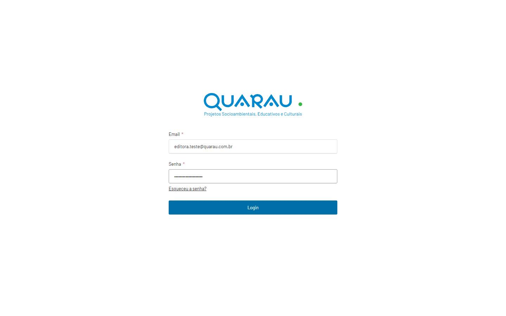
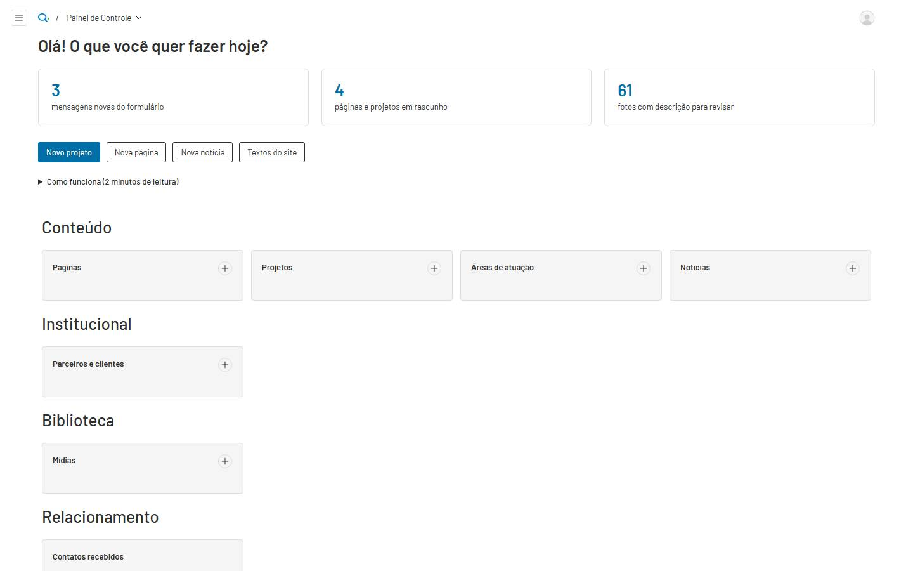
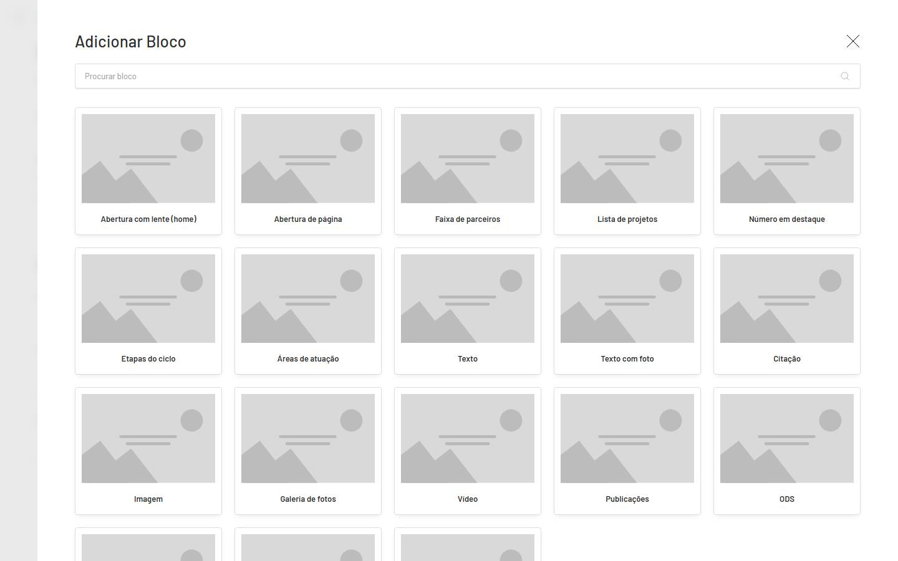
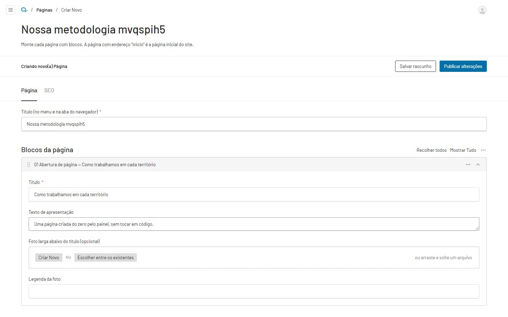
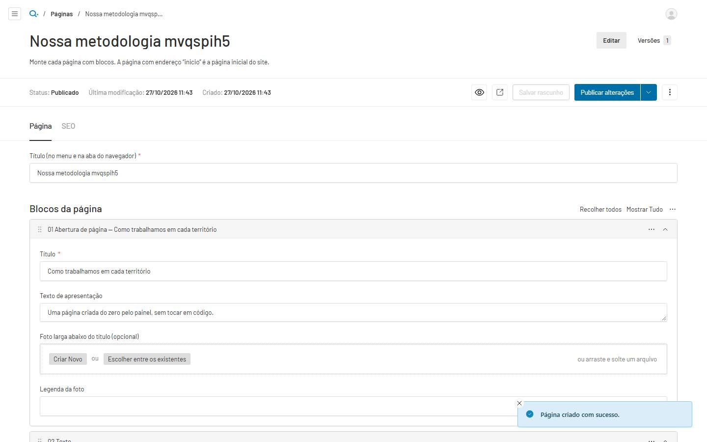

# Guia do painel — para quem edita o site

Para a equipe da Quarau, sem conhecimento técnico. O painel fica em **`/admin`** (ex.: `https://quarau.com.br/admin`).
As imagens abaixo são do teste real feito com uma editora no site publicado ([`qa/depois/leigo/`](qa/depois/leigo/)).

> **Regra de ouro:** o site só muda quando você clica em **Publicar alterações**. **Salvar rascunho** guarda sem
> mudar o site. **Visualizar** (ícone de olho) mostra a página como vai ficar.

## 1. Entrar

Abra `/admin`, digite e-mail e senha e clique em **Login**. Depois de 5 senhas erradas, o acesso fica bloqueado por
15 minutos. A senha precisa ter pelo menos 12 caracteres. Esqueceu? **Esqueceu a senha?** envia um link por e-mail.

## 2. A tela inicial

Mostra o que pede atenção (mensagens novas do formulário, rascunhos, fotos sem descrição) e atalhos: **Novo projeto**,
**Nova página**, **Nova notícia**, **Textos do site**. Em **Como funciona** há um resumo de 2 minutos.

## 3. Criar uma página do zero

1. **Nova página** → escreva o **Título** (é o nome no menu e na aba do navegador).
2. **Adicionar bloco** → escolha o bloco. Comece por **Abertura de página** (título grande e texto de apresentação).
3. Adicione os blocos seguintes: **Texto**, **Texto com foto**, **Galeria de fotos**, **Citação**, **Lista de
   projetos**, **Chamada para contato**… Cada bloco aparece com número e nome ("02 Texto — …"). Arraste pelo ⋮⋮ para
   reordenar; o menu ⋯ duplica ou remove.
4. **Publicar alterações**. O endereço da página é criado a partir do título (campo **Endereço**).

Para pôr a página no menu: **Configurações do site → Menu principal → Adicionar item → Página do site**.

## 4. Projetos

**Projetos → Novo projeto**. A aba **Ficha** tem o que aparece no topo da página: nome, resumo, foto de capa,
território, quem realiza, papel da Quarau, anos, parceiros, áreas e ODS. **Deixe vazio o que não estiver confirmado:
campo vazio não aparece no site.** A aba **História** monta o texto com blocos (texto, citação, foto, galeria, vídeo,
publicações). **Destaque** e **Ordem** (barra lateral) controlam as listas.

## 5. Fotos

Envie a foto original; o site gera as versões otimizadas sozinho. Formatos: JPG, PNG, WebP, AVIF, GIF, MP4, WebM e
PDF (SVG não é aceito por segurança). Todo arquivo precisa de **Texto alternativo**: descreva o que aparece, para
quem não enxerga a imagem. Fotos marcadas **precisa de revisão** vieram da importação com descrição automática.

> No endereço temporário de demonstração o envio de arquivos está desligado (falta o armazenamento definitivo);
> o aviso aparece na tela.

## 6. Textos do site, menu, rodapé e contato

Em **Configurações do site**:

- **Textos do site:** todos os rótulos, botões, mensagens de erro, aviso de cookies e página 404.
- **Menu principal** e **Rodapé:** links (sempre apontando para páginas do site).
- **Contato e dados da empresa:** e-mail, telefones (marque WhatsApp só se confirmado), quem recebe as mensagens do
  formulário, assuntos do formulário, razão social, CNPJ e endereço (aparecem no rodapé quando preenchidos).
- **SEO e compartilhamento:** nome do site, descrição padrão para o Google e imagem ao compartilhar o link.
- **Redirecionamentos:** quando um endereço muda, aponte o antigo para o novo.

## 7. Agendar, versões e mensagens

- **Agendar:** na seta ao lado de **Publicar alterações** → **Agendar publicação**. Acontece em até 15 minutos
  depois do horário (na VPS, em até 1 minuto).
- **Versões:** a aba **Versões** de cada página guarda o histórico; abra uma versão e clique em **Restaurar**.
- **Contatos recebidos:** mensagens do formulário. Mude a **Situação** (novo → em atendimento → respondido). São
  dados pessoais (LGPD): não exporte nem compartilhe; apague a pedido do titular.

## 8. Papéis

| Papel         | Pode                                                                              |
| ------------- | --------------------------------------------------------------------------------- |
| Administrador | tudo, inclusive criar usuários e mudar papéis                                     |
| Editor        | criar, editar e publicar conteúdo; editar configurações do site; ler as mensagens |
| Autor         | criar rascunhos e editar os próprios; não publica nem apaga                       |
